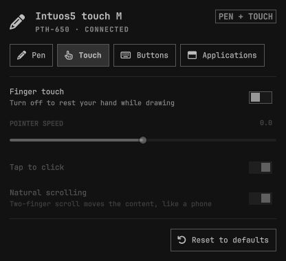
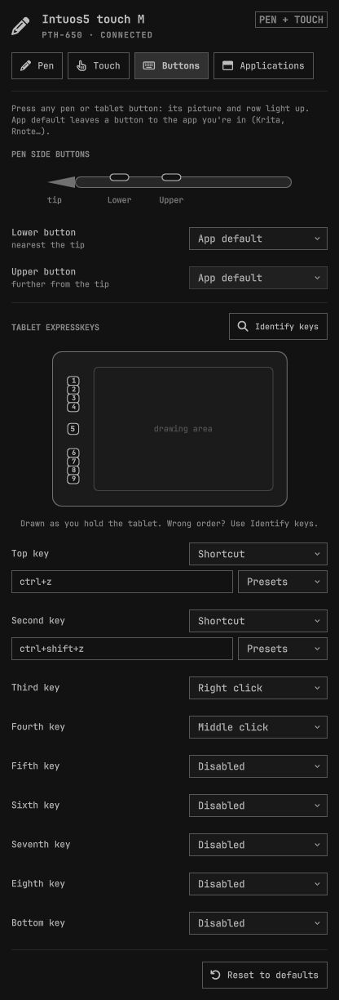
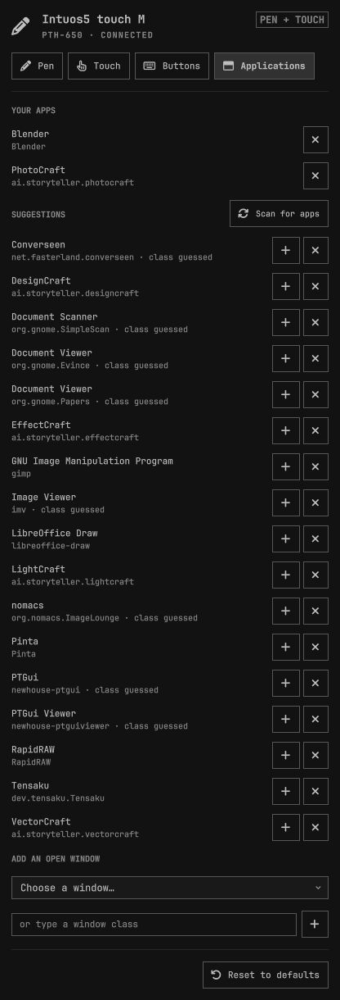
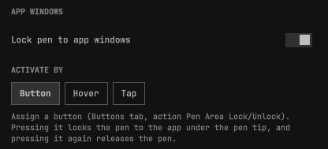
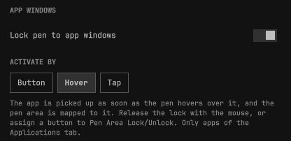
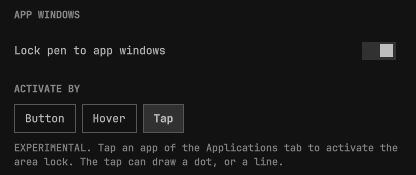
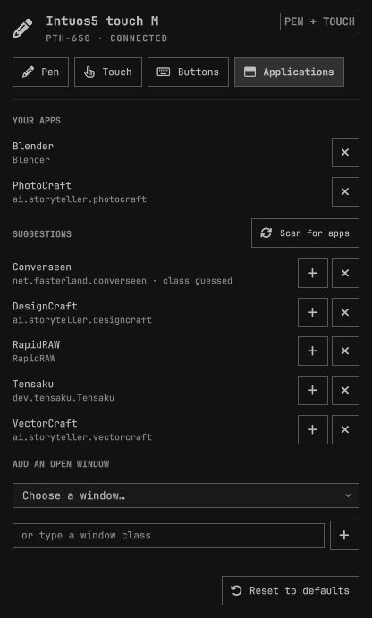

# Wacom Bamboo for Omarchy

A bar widget for the [Omarchy](https://omarchy.org) shell that sets up a Wacom
pen tablet from the bar: which display the pen draws on, orientation
(including flipped for left-handed use), active area, pressure, finger touch,
and what every pen and tablet button does. It can also lock the pen to the
window of the drawing apps you choose.


<details>
<summary><b>Additional Screenshots</b></summary>

<table>
<tr>
  <td align="center" valign="top">
    <a href="ReadMe-Images/omarchy-tablet_TouchTab.jpg"></a><br>
    <sub><strong>Touch Tab</strong></sub>
  </td>
  <td align="center" valign="top">
    <a href="ReadMe-Images/omarchy-tablet_ButtonsTab.jpg"></a><br>
    <sub><strong>Buttons Tab</strong></sub>
  </td>
  <td align="center" valign="top">
    <a href="ReadMe-Images/omarchy-tablet_ApplicationsTab.jpg"></a><br>
    <sub><strong>Applications Tab</strong></sub>
  </td>
</tr>
</table>

</details>

## Features

- **Pen** – target display (any monitor or all of them), active-area size with
  a scale preview, crop to the display's aspect ratio so circles stay round,
  pressure sensitivity.
- **Orientation** – *Flipped* turns the pen, finger touch and the key order
  around for left-handed use. *90°* and *270°* hold the tablet portrait: pen,
  finger touch and key order all turn with it, and palm rejection keeps working.
- **Touch** – finger touch on/off (handy while drawing), pointer speed, tap to
  click, natural scrolling.
- **Buttons** – remap the pen side buttons and the ExpressKeys to a click, a
  keyboard shortcut (`ctrl+z`, `ctrl+shift+s`, `super+w`…), any shell command,
  or nothing, or leave them on **App default** so drawing apps (Krita, Rnote…)
  still get them. Presets cover the usual drawing shortcuts (undo, hold space
  to pan, brush size, eraser, zoom) and commands (toggle finger touch,
  screenshot, colour picker); **Test** runs a command on the spot. The tablet
  is drawn from its real layout; press a physical button and its picture and
  row light up. **Identify keys** relearns the key order if a model's data is
  incomplete.
- **App windows** – lock the pen to the window of chosen apps (PhotoCraft,
  Blender, Krita…): the whole tablet then maps onto that window, in its aspect
  ratio so circles stay round, and the pen can't leave it. Everywhere else the
  pen covers the desktop as before. See [App windows](#app-windows).
- **Applications** – the list of apps for the lock, filled from the drawing
  apps (Graphics category) found on the system, from the windows open now, or
  by typing a window class.
- The panel adapts to the tablet that's plugged in: tabs and buttons it doesn't
  have are hidden, and the bar icon disappears while no tablet is connected.
  Changes apply instantly and survive reboots. Colours and fonts follow the
  current Omarchy theme.

## APP WINDOWS

Switch **Lock pen to app windows** on in the Pen tab, then choose how the lock starts (see below). With **Hover** and **Tap**, also add your drawing apps in the **Applications** tab. **Button** works with any window, so it needs no list.



- **Activate by Button** (the default): assign a tablet key or pen button to
  **Pen Area Lock/Unlock** in the Buttons tab. Pressing it locks the pen to the
  window under the pen tip, whether or not the app is in the list; pressing it
  again releases the pen.



- **Hover** picks the app up as soon as the pen hovers over it, with no click, but
  passing over a listed app on the way somewhere else then locks the pen to it.
  Release the lock with the mouse, or with a button set to Pen Area Lock/Unlock.



- **Tap** (experimental): tap a listed app and the pen locks to it as soon as it
  lifts. The tap itself still reaches the app, so it can draw a dot, or a line if
  you start painting at once as the area changes.
- **Attention**: In **Hover** and **Tap** mode the pen is released when focus moves to another window by either using super+tab to tab to another window, moving the mouse to another window, clicking or pressing the defined button on the pen or the tablet, or closing the app. In Button mode it stays on its window until you press the key again, the window closes or it leaves the screen.

- **Pro Tip** To leave the lock mode, when you are using the pen alone, set a tablet key or pen button to **Pen Area Lock/Unlock** in the Buttons tab: it releases the pen, and pressing it again locks the pen back onto the app in focus.

**General Notes**
- While the pen is locked, a resized or moved window is followed and the pen motion is locked to that window.
- The pointer jumps once when the lock engages, from where the pen was on the desktop to the same spot on the tablet inside the window. 90° and 270° orientations don't lock yet.

### The Applications tab

The list is used by **Hover** and **Tap**. In **Button** mode the tab is greyed out, because the button locks whichever window is under the pen.



- **Scan for apps** lists the installed drawing apps (the Graphics category of
  the app launcher). Add the ones you use, or dismiss the ones you don't want
  to lock the pen to; dismissed apps can be brought back.
- To add an App from the list, click the "+" icon. It will slide up under **Your Apps**
- To remove an app from the **Your Apps** list, click the "X" icon. It will slide back to the ignored list.
- To remove an app from the list completely, click the "X" on the item in the ignore list and it will be removed.
- **Add an open window** takes the window class from a window that is open now, which is the sure way for apps whose launcher doesn't name their class.
- A window class can also be typed in. In a console find the app name using `hyprctl clients`.

## Settings in `tablet.json`

All of this is set from the panel; the keys are listed for scripting.

| Key                     | Meaning                                                              |
| :----------------------- | :-------------------------------------------------------------------- |
| `areaLock`              | Lock the pen to the windows of the apps below.                       |
| `areaActivate`          | `"button"` (default), `"hover"` or `"tap"`.                          |
| `apps`                  | Window class → `{"mode": "window"}`. Matched without regard to case. |
| `ignoredApps`           | Classes the app scan no longer suggests.                             |

## Supported hardware

Any Wacom tablet handled by the kernel `wacom` driver, which splits a tablet
into `… Pen`, `… Finger` and `… Pad` input devices. The model name, touch
support, key codes and key layout come from **libwacom**, already installed on
every Omarchy system as a libinput dependency; the active-area size comes from
the driver.

✅ = confirmed working on real hardware · ☐ = should work (checked against
libwacom's data and with virtual devices), not tried yet

| | Family | Models | Notes |
|---|---|---|---|
| ✅ | Bamboo Pen & Touch, Fun, SE | CTH-460/461/661 and (A)/SE variants | CTH-460(A), the author's tablet: pen, touch, 4 keys, every orientation |
| ✅ | Intuos5 | PTH-650 | [Reported by a user](https://github.com/mug31/omarchy-tablet/issues/1): every key recognised. 8 keys, touch; the touch ring isn't handled |
| ☐ | Bamboo Capture, Create, 16FG | CTH-470/670, CTT-470 | 4 keys, touch |
| ☐ | Bamboo Touch | CTT-460/460(A) | touch and keys, no pen |
| ☐ | Bamboo Pen, Connect, One | CTL-460/660/470, CTF-430, CTE-660 | pen only |
| ☐ | Bamboo Fun / Pen (older) | CTE-450/650, MTE-450 | 4 keys along the top |
| ☐ | Bamboo Pad | CTH-300/301 | 2 keys, touch |
| ☐ | Intuos S/M, One by Wacom | CTL/CTH-480/490/680/690, CTL-4100/6100, CTL-471/472/671/672 | Intuos Pen & Touch 1st/2nd gen: run **Identify keys** once, libwacom doesn't record their key order |

Got it working on a model not ticked here, or found one that doesn't?
[Open an issue](https://github.com/mug31/omarchy-tablet/issues) with the model
number and it'll be added.

Huion, XP-Pen and other brands use different drivers and are not supported.
Touch rings and strips on pads are not handled.

## Requirements

- Omarchy 4.x with the Lua Hyprland config (`~/.config/hypr/hyprland.lua`).

- The kernel `wacom` driver. Check with `lsmod | grep wacom`.
  **OpenTabletDriver blocks it** (`/usr/lib/modprobe.d/99-opentabletdriver.conf`).
  To use this widget instead of OpenTabletDriver:

  ```bash
  systemctl --user disable --now opentabletdriver.service
  sudo sh -c ': > /etc/modprobe.d/99-opentabletdriver.conf'   # override the block
  sudo modprobe wacom                                          # then replug the tablet
  ```

Nothing else to install: the widget only uses Python's standard library.

## Install

```bash
omarchy plugin add https://github.com/mug31/omarchy-tablet.git --enable
```

That's it: there is no setup step and the Hyprland config is never edited.

**Button remapping and portrait** need to grab the tablet and create virtual
input devices, which a stock Omarchy keeps to root. If so, the panel shows
**Enable**: it asks for your password once (pkexec) and installs
`/etc/udev/rules.d/70-omarchy-wacom-bamboo.rules`, which gives the logged-in
user access to `/dev/uinput` and to Wacom tablets only. It takes effect
straight away, without logging out.

**Updating from 0.3 or older** happens on its own the first time the bar
loads 0.4: the `require("hypr.tablet")` line is removed from
`hyprland.lua` (the old file is kept as `hyprland.lua.wacom-bamboo.bak`),
`tablet.lua` becomes `tablet.lua.bak`, and the `tablet-buttons` systemd
service is stopped and its unit kept as `tablet-buttons.service.bak`.
Settings and button mappings carry over.

## How it works

| Piece | Role |
| :--- | :--- |
| `Panel.qml` | The bar icon and panel. Every change is sent to `bin/tablet-ctl`. |
| `bin/tabletlib.py` | Finds the tablet in `/proc/bus/input/devices` and reads its libwacom entry and layout. |
| `bin/tablet-ctl` | Saves settings to `~/.config/omarchy/tablet.json` and sends them to Hyprland with `hyprctl eval`. |
| `bin/tabletarea.py` | Runs inside `tablet-buttons`. Follows Hyprland's event socket and maps the pen onto a window with `region_position` / `region_size`, using the part of the tablet that has the window's aspect ratio. In Button mode the key locks the focused window and the lock stays on that window, whatever has focus, until the key is pressed again, the window closes or it leaves the screen; in Hover and Tap mode it is a listed app, and the pen is released when focus leaves. Also reads the installed launchers for the app scan. |
| `bin/tablet-buttons` | Helper the panel keeps running (one per session; extra bars wait their turn). Re-applies the settings when the session starts, the tablet is plugged in, Hyprland reloads its config or a monitor changes. While any ExpressKey is remapped it grabs the pad and runs the actions through a virtual keyboard and mouse; keys left on App default are replayed through a virtual pad of the same name, so apps still see them. The pen is grabbed while a side button is remapped or the tablet is portrait, and replayed through a virtual clone (`… Pen Remap`) so pressure and tilt keep working; in portrait the finger touch is replayed turned (`… Finger Rotated`). Log: `~/.cache/omarchy-tablet/tablet-buttons.log`. |
| `bin/evio.py` | Minimal evdev/uinput access (reading, grabbing, virtual devices) from the standard library. |

The app settings are only read by `tablet-buttons`; changing
them sends nothing to Hyprland.

`python3 -m unittest discover tests` runs the checks for the window and
launcher maths.

`bin/tablet-ctl toggle fingerEnabled` flips finger touch on or off with a
notification, so it can go on a tablet button or a Hyprland keybinding.

## Uninstall

```bash
omarchy plugin remove io.github.mug31.wacom-bamboo
rm ~/.config/omarchy/tablet.json                            # saved settings
sudo rm /etc/udev/rules.d/70-omarchy-wacom-bamboo.rules     # only if you pressed Enable
```

The settings were only ever applied at runtime, so they are gone after the
next Hyprland reload or login.

## Contributing

Issues and PRs are welcome. For anything bigger than a small fix, open an
issue first so we can agree on the approach. Please leave version numbers to
me, and mention which tablet you tested on.

## License

MIT
